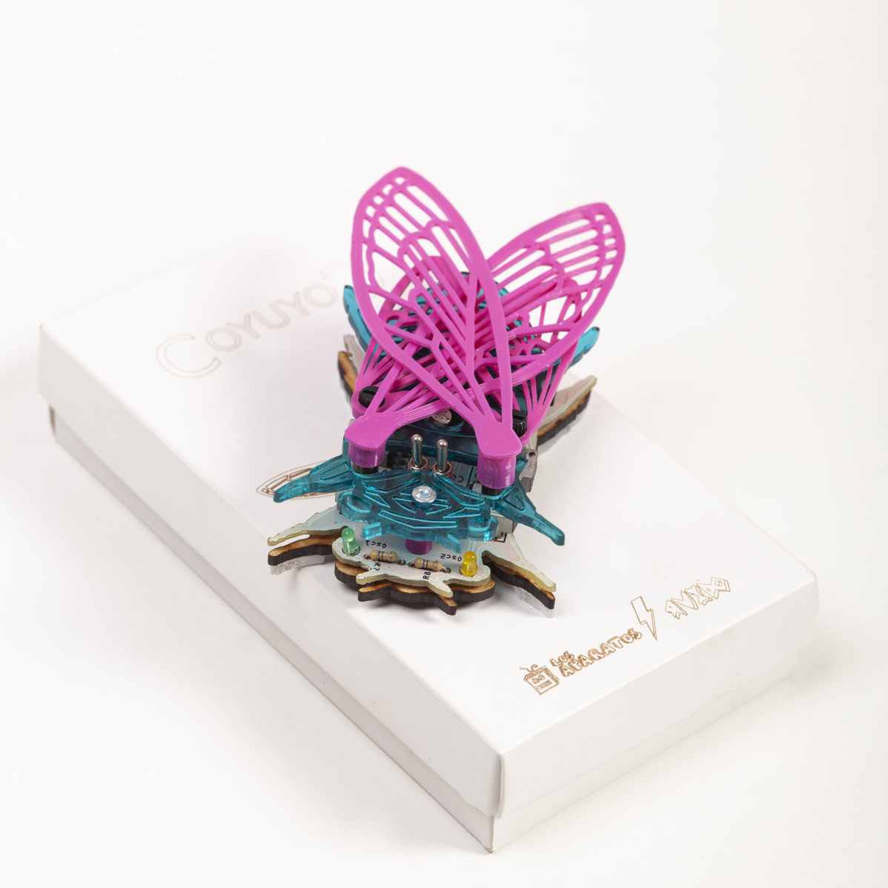

# CoyuyoC

A handmade analog drone synthesizer, designed and built by [Los Aparatos](https://losaparatos.com.ar) in Tucumán, Argentina.

## What is it?

CoyuyoC is an analog drone synth — a fully analog circuit built for continuous, evolving textures rather than conventional melodic playing. No microcontroller, no code. A handmade analog drone synthesizer from Tucumán, Argentina, based on an original drawing by artist Verónica Corrales.

## How it works

CoyuyoC is built around a single 556 dual timer IC (two 555 timers in one chip), configured as two independent oscillators: an LFO and a VCO. Each has its own independent audio output per channel, but depending on the switch positions, the VCO can be controlled by the LFO — either directly or through a photoresistor (LDR).

The waveform isn't a standard square wave: instead, it's taken from the charge/discharge curve of each oscillator's associated capacitor, buffered through a pair of transistors in a unity-gain amplifier configuration. Each potentiometer — the "wings" — controls the rising or falling ramp of its oscillator, shaping a waveform similar to a "shark fin." It has a Voltage Controlled Input.

## Repository contents

- `/schematics` — circuit schematic
- `/images` — photos of the finished instrument

## About Los Aparatos

Los Aparatos is an electronic design studio building experimental musical instruments — synthesizers, sound toys and DIY kits — handmade in Tucumán, Argentina, since 2007.

Other instruments: [Auduina](https://gitlab.com/los-aparatos/auduina) (granular synth), Drawdio (a sound pencil that turns drawing into sound), Theremingo (an analog theremin).

## Where to buy

[losaparatos.com.ar](https://losaparatos.com.ar) · [Tindie](https://www.tindie.com/stores/mateoaparato/) · [Etsy](https://losaparatos.etsy.com) · [Reverb](https://reverb.com/shop/los-aparatos)

## License

[CC BY-NC-SA 4.0](https://creativecommons.org/licenses/by-nc-sa/4.0/)